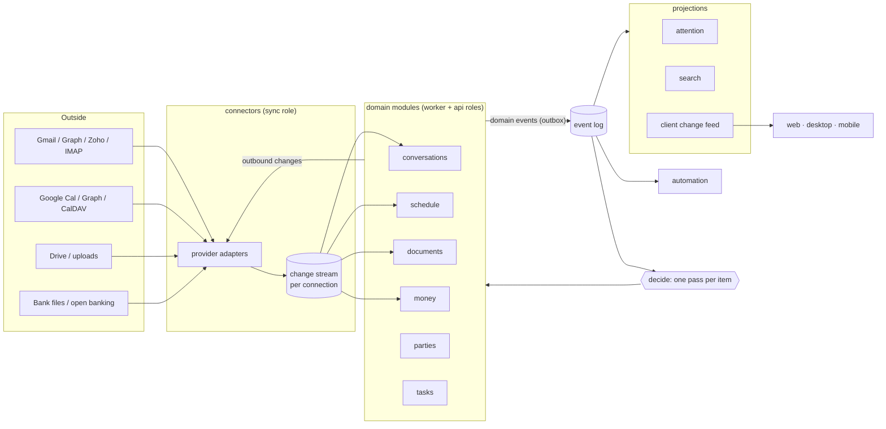
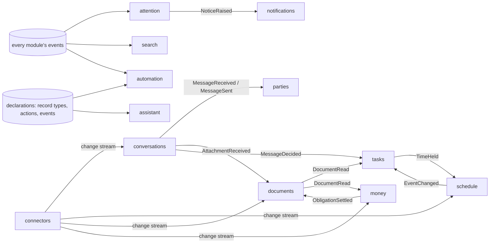

# Domain map

What Campbooks Next is made of and how it scales: the shape of the system,
the bounded contexts (one module crate each), the language each one speaks,
how they talk, and the order they ship in.

Decisions behind it:
[0008](adr/0008-platform-ready-typed-core.md) platform seams ·
[0009](adr/0009-decide-role-typed-decision-model.md) the `decide` role ·
[0010](adr/0010-connectors-and-change-streams.md) connectors and change streams ·
[0011](adr/0011-scaling-shape.md) process roles, storage and tenancy.

The Rails app on `main` was read only to remember what users needed
([Appendix A](#appendix-a--what-users-needed)). None of its architecture is
carried over.

## Design goals

1. **Cost follows activity, not accounts.** An idle workspace costs almost
   nothing: no per-account polling loops, no periodic refresh jobs, no AI on
   mail nobody will see. Work happens when something changes.
2. **Every source is a change stream.** Mail, calendars, files and bank data
   all enter through the same connector machinery, so adding a provider or a
   channel never touches a domain module.
3. **One AI pass per item.** A new item gets *one* `decide` call that answers
   every question about it at once (Laya answers many typed questions in a
   single forward pass). Generation happens only when a decision or the user
   asks for it.
4. **Write models are typed; read models are projections.** Domain modules
   own typed tables. Everything cross-cutting — the attention queue, search,
   people's standing, client caches — is a projection of the event log and
   can be rebuilt by replaying it.
5. **Declare once.** Record types, actions and events are declared by the
   module that owns them; the API, MCP, assistant tools, rules and command
   palette are generated from the declarations.
6. **Same binary, any scale.** Self-hosters run one process; the hosted cloud
   runs the same image as separate roles that scale independently.

## The shape of the system

- **Connectors** turn every provider into a normalised, cursor-based change
  stream (push where the provider offers it, adaptive polling where it
  doesn't) and carry outbound changes back. They own credentials, rate limits
  and retries. Domain modules never call a provider SDK.
- **Domain modules** apply changes to their typed tables and publish domain
  events through the outbox.
- **The event log** drives everything downstream: projections, automation
  rules, the AI pass, notifications, and the client change feed.
- **Clients** keep a local cache per workspace and stay current from a change
  feed (server-sent events with a cursor), so lists don't refetch and a
  reconnecting device catches up from its last cursor. Full offline editing
  is a later step on the same feed.

Details and trade-offs: ADR 0010 (connectors) and ADR 0011 (roles, storage,
tenancy).

## Contexts

| Module | One line | Milestone |
| --- | --- | --- |
| `system` | Health, version. Exists. | M0 |
| `workspaces` | Tenants, members, roles, invitations, signup policy, security log. | M0 |
| `connectors` | Links to outside accounts, credentials, sync engine, provider adapters. | M0 |
| `identity` | Accounts and their ways in (every owned mailbox, passkeys); the instance's OAuth 2.1 issuer (ADR 0014). | M0 |
| `conversations` | Messages on any channel (email first), inboxes, threads, drafts, streams. | M1 |
| `parties` | The people, services and organisations the workspace deals with. | M1 |
| `attention` | What needs someone now, and the log of what Campbooks did. | M1 |
| `search` | One index over every record a member may see. | M1 |
| `notifications` | Getting a notice to the right person on the right device. | M1 |
| `schedule` | Calendars, events, availability. | M2 |
| `tasks` | What someone owes or has to do, and when they'll do it. | M2 |
| `automation` | Rules over any declared event and action. | M2 |
| `documents` | Files, folders, document types and the facts read from them. | M3 |
| `money` | Bank accounts, statement lines, reconciliation, loans. | M3 |
| `assistant` | Conversations with Campbooks that act through declared actions. | M4 |
| `records` | Custom record types and custom fields on any record. | M5 |
| `views` | Saved views and dashboards over any record type. | M5 |

Not modules: plans, billing and entitlements are **cloud-only** and live
outside this repo; model calls live in **`campbooks-ai`**.

## How contexts talk

Rules:

- **Events by default.** A module reacts to another's events and keeps a
  small projection of what it needs (money keeps *obligations* projected from
  `DocumentRead`; it never queries documents' tables).
- **Ports for the few synchronous needs**, defined as traits in the kernel and
  implemented by one module: `Credentials` (connectors), `Access` (who may see
  a container), `Decide` (the AI pass, implemented over `campbooks-ai`).
- **References, not joins.** Any record is addressable as
  `RecordRef { type, id }`; that's how a task points at the message it came
  from, and how attention, search and rules point at anything.

## The contexts

Each lists its **language** (terms no other module may redefine), the events
it **publishes** and **consumes**, and its **AI** use. `decide` questions
are typed (`choice`, `score`, `noul`) and all asked in the item's single pass.

### workspaces

**Language**
- **Workspace** — a household or business whose data is kept together and
  apart from everyone else's. _Avoid_: account, company.
- **User** — someone who signs in; an IdP subject. Belongs to any number of
  workspaces. _Avoid_: account.
- **Member** — a user's membership of a workspace, with a **role** (`owner`,
  `admin`, `member`). _Avoid_: seat.
- **Invitation**, **Signup policy** (`open`, `invite_only`, `approval`,
  `code`), **Security event**.

**Publishes** `WorkspaceCreated`, `MemberJoined`, `MemberLeft`,
`MemberRoleChanged`, `WorkspaceDeleting`. **AI** none.

### connectors

The only place that knows about providers.

**Language**
- **Connection** — a member's authorisation for Campbooks to use one outside
  account, with the **capabilities** it grants (`messages`, `calendar`,
  `files`, `bank`). One Google consent can grant all three. _Avoid_:
  integration, grant, email account.
- **Adapter** — the code for one provider and capability (Gmail messages,
  Graph calendar, IMAP, CalDAV, …).
- **Change stream** — the ordered, de-duplicated changes an adapter reads
  from a connection, with a **cursor** that marks how far Campbooks has read.
- **Outbound change** — a change a domain module wants made at the provider
  (send, move, accept, create event), carried out with retries and conflict
  checks.
- **Health** — `ok`, `needs_reauth`, `throttled`, `failing`.

**Publishes** `ConnectionAdded`, `ConnectionNeedsReauth`,
`ConnectionRemoved`, and the change streams themselves (consumed by the
owning domain module per capability). **Consumes** outbound changes.
**AI** none.

### conversations

Everything that arrives and leaves as a message. Email is the first
**channel**; chat apps and SMS fit the same model later.

**Language**
- **Channel** — a kind of messaging (`email` today).
- **Inbox** — one address the workspace receives and sends on, on one
  channel, shared with members as `reader`, `sender` or `manager`. _Avoid_:
  mailbox, account.
- **Conversation** — the exchange a message belongs to (an email thread).
  **Message** — one item in it. _Avoid_: thread (UI word only), email.
- **Stream** — the one place Campbooks sorts a conversation into. A small
  built-in set plus the workspace's own; every conversation is in exactly one.
  _Avoid_: tag group, category, folder.
- **Label** — the member's own mark on a conversation, mirrored with the
  provider when it has labels. _Avoid_: tag.
- **Draft**, **Scheduled send**, **Signature**.

**Publishes** `MessageReceived`, `MessageSent`, `MessageDecided` (the AI
pass result), `ConversationSorted`, `AttachmentReceived`,
`ConversationAwaitingReply`. **Consumes** its change streams;
`PartyKindChanged`.
**AI** one pass per inbound message: stream (`choice`), needs a reply
(`noul`), asks the member for something (`noul`), contains a deadline
(`noul`), urgency (`score`), suspicious (`noul`). `complete` only on demand
or behind a gate: drafts, rewrites, summaries.

### parties

**Language**
- **Party** — someone the workspace deals with: a **person** or a **service**
  (newsletters, receipts, notifications). The member can correct which.
  _Avoid_: contact, sender.
- **Address** — one way to reach a party on one channel. _Avoid_: alias.
- **Organisation** — a company or institution parties belong to.
- **Standing** — what's open between the workspace and a party, and who
  holds the last word (a projection).
- **Importance** — the member's say on how much a party matters.

**Publishes** `PartyCreated`, `PartyKindChanged`, `PartiesMerged`.
**Consumes** `MessageReceived`, `MessageSent`, `TaskCreated`, `TaskDone`.
**AI** person or service (`choice`) in the message's pass; same party
(`noul`) to propose merges.

### attention

One queue of what needs each member, fed by every module.

**Language**
- **Attention item** — one thing that needs a member, pointing at a record
  (`RecordRef`), with a **reason** declared by the module that raised it
  (reply, decide, do, pay, chase, review, …) and the time it matters by.
  _Avoid_: feed item, card.
- **Log** — what Campbooks did on someone's behalf, each entry undoable while
  the owning module allows it.

**Consumes** every module's "needs attention" and "resolved" events.
**Publishes** `NoticeRaised`. **AI** none in the queue itself; ranking is
deterministic and explainable.

### search

**Language**
- **Index entry** — a searchable projection of one record: text, chunks,
  vectors and its access container. **Query** — what the member typed, parsed
  into filters and text.

**Consumes** `*Indexed` / `*Removed` events. **AI** `embed` for chunks and
queries; `decide` to parse filters from a query (`choice`).

### notifications

**Language**
- **Notice** — a message to one member about one thing, on a **channel**
  (`in_app`, `push`, `email`) at a **priority**. **Device**, **Digest**.

**Consumes** `NoticeRaised`. **AI** none.

### schedule

**Language**
- **Calendar** — a provider calendar the workspace syncs, shared as `reader`,
  `writer`, `manager`.
- **Event** — something at a time on a calendar; **occurrence** — one
  instance of a recurring event. **Event type** — the workspace's own kinds.
- **Availability** — a member's free time within working hours.

**Publishes** `EventCreated`, `EventChanged`, `EventCancelled`.
**Consumes** its change streams; `TimeHeld`. **AI** event type (`choice`) in
the event's pass; `complete` to propose an event from a message.

### tasks

What someone owes or has to do, from any origin, and when they'll do it.

**Language**
- **Task** — something a member has to do. Its **origin** is an **ask** (a
  party asked), a **deadline** (a dated obligation found in a message or
  document), or **own** (the member wrote it). _Avoid_: reminder, to-do,
  commitment.
- **Due** — when it must be done. **Plan** — when the member will do it: a
  date, a **hold** (time blocked on the calendar) or **later**.
- **Hand-off** — giving a task to another member.

**Publishes** `TaskCreated`, `TaskDue`, `TaskDone`, `TaskHandedOff`,
`TimeHeld`. **Consumes** `MessageDecided` (asks and deadlines flagged by the
pass), `DocumentRead`, `EventChanged`.
**AI** same-task (`noul`) against open tasks before creating one;
`complete` extracts title, party and due date only for items the pass
flagged.

### automation

**Language**
- **Rule** — *when* a trigger fires, *if* conditions hold, *do* actions.
  _Avoid_: workflow, filter, inbox rule.
- **Trigger** — a declared event, a schedule or an incoming webhook.
- **Condition** — a test on the event's data, or a `decide` question.
- **Action** — a declared action of any module.
- **Run** — one execution, recorded with inputs, outputs and undo.

**Consumes** every declared event. **AI** `decide` conditions.

### documents

**Language**
- **File** — a stored blob with a name, from any source. _Avoid_: upload,
  attachment.
- **Document** — a file Campbooks has read: a **document type** plus **facts**
  extracted against that type's schema. _Avoid_: paper.
- **Document type** — a kind of document with a fact schema; built-in or the
  workspace's own.
- **Folder** — where files live; shared as `reader`, `writer`, `manager`.
- **Review** — a member confirming or correcting type and facts.
- **Share link** — a public, revocable link to one file.

**Publishes** `FileStored`, `DocumentRead`, `DocumentReviewed`,
`DocumentNeedsReview`. **Consumes** `AttachmentReceived`, its change
streams, `ObligationSettled`. **AI** type (`choice`, coarse to fine past ~20
types) in the file's pass; `vision`/`complete` for facts.

### money

Whether money that should have moved did. Says nothing about a payment until
bank data covers its date.

**Language**
- **Bank account**; **Line** — one movement of money on it, from a statement
  file or a bank connection. _Avoid_: transaction.
- **Obligation** — money owed to or by the workspace, projected from a
  document's facts. _Avoid_: invoice (one kind of source).
- **Match** — a line linked to an obligation, `proposed` or `confirmed`.
  **Settled** — an obligation with a confirmed match.
- **Loan** — repayments on a schedule of **instalments**.

**Publishes** `LinesImported`, `ObligationSettled`, `ObligationOverdue`.
**Consumes** `DocumentRead`, its change streams. **AI** deterministic
matching first; `decide` (`noul`) only for the ambiguous band; `vision` for
lines in PDF statements.

### assistant

**Language**
- **Chat** — a conversation between a member and Campbooks, optionally about
  one record. _Avoid_: conversation (that's messaging), thread.
- **Tool** — a declared action the assistant may call; mutating tools return
  proposals the member confirms.
- **Memory** — what the member taught Campbooks, shown as sentences backed
  by real rules and settings.

**AI** `complete` for the chat and tool choice.

### records and views (platform)

- **Record type** — built-in (declared by a module) or **custom** (defined by
  a workspace). **Field**; **custom field** — added to any record type,
  stored by `records` against a `RecordRef`.
- **View** — a saved query over a record type (list, board, calendar);
  **Dashboard** — a page of views and charts.

## Milestones

| Milestone | Ships | A member can… |
| --- | --- | --- |
| **M0 Foundations** | `workspaces`, `connectors` (engine + Google), IdP, BFF, native sign-in, outbox and queue, AI gateway with Laya, change feed | sign in, create a workspace, connect Google |
| **M1 An inbox that sorts itself** | `conversations` (email), `parties`, `attention`, `search`, `notifications`; Microsoft and IMAP adapters | read and send mail sorted into streams, see what needs them |
| **M2 The day** | `schedule`, `tasks`, `automation` | see their day, turn messages into tasks, hold time, write rules |
| **M3 Paperwork** | `documents`, `money` | keep documents read and searchable, reconcile a bank account |
| **M4 Assistant** | `assistant`, MCP from declarations | ask Campbooks to act across everything |
| **M5 Platform** | `records`, `views` | define their own records, fields, views and dashboards |

Each module's baseline spec (`openspec/specs/<module>/spec.md`) is written by
the first OpenSpec change that implements it, so no spec exists without code
behind it. The purposes and requirements below seed those changes.

## Module stubs

- **workspaces** — users in many workspaces; role checked on every action;
  invitations; per-instance signup policy; security log; workspace deletion
  fans out to every module via `WorkspaceDeleting`.
- **connectors** — push first, adaptive polling otherwise (idle connections
  back off to near zero); per-provider rate limits and per-tenant fairness;
  idempotent apply by provider id; credentials encrypted and never returned;
  host guard for IMAP/CalDAV on hosted instances; health and re-auth.
- **conversations** — sync is a pure consumer of change streams; message
  bodies and attachments in object storage, metadata in Postgres; one AI pass
  per inbound message with every confidence recorded; corrections stored as
  labelled examples; send/draft/schedule as outbound changes.
- **parties** — one party per real-world counterpart across channels and
  inboxes; merges proposed, never silent.
- **attention** — rebuilt by replaying events; nothing shown that the member
  can't open; every automatic action logged with undo.
- **search** — access enforced at query time; re-index on model change
  without downtime; hybrid ranking.
- **notifications** — per-member preferences per reason; digest; push.
- **schedule** — two-way sync through connectors with conflict checks;
  recurring occurrences; availability.
- **tasks** — one task per real obligation across origins; holds live on the
  calendar; hand-off.
- **automation** — dry run; runs recorded with undo; a rule can only do what
  its author may do; loop protection.
- **documents** — blobs content-addressed in object storage (one copy per
  workspace however many messages carry it); type and facts with confidence;
  review teaches; revocable share links.
- **money** — silent until bank data covers the date; deterministic matching
  first; matches confirmed by a member.
- **assistant** — only declared actions; mutations as proposals.

## Appendix A — what users needed

From the Rails app on `main`, as needs, not designs.

| Need | Where it lands |
| --- | --- |
| Connect Gmail, Zoho, Microsoft 365, any IMAP mailbox; mail that stays current | `connectors` adapters + `conversations` |
| Read, reply, forward, archive, snooze, star, label, move, bulk actions | `conversations` actions (declared once) |
| An inbox that sorts itself; see who's waiting on you; follow-ups | streams + AI pass; `attention`; `ConversationAwaitingReply` |
| Drafts in the member's voice; shorter/warmer rewrites; signatures; scheduled send | `conversations` + `complete` |
| One record per person; services told apart from people; organisations | `parties` |
| Rules that tidy the inbox; automations across tools | `automation` |
| Two-way calendar; day/week/month views; event from a message | `schedule` |
| Things people asked of me, bills and renewals, time to do them, hand-offs | `tasks` |
| Documents read from attachments, links and uploads; types and fields; review; folders; share links | `documents` |
| Send documents to Drive or Notion | declared `documents` actions using a connection |
| Reconcile bank statements against invoices and receipts; loans; accountant exports | `money` |
| An assistant that answers and acts; teach it habits | `assistant` |
| Search everything | `search` |
| Notifications, push, a daily digest | `notifications` |
| Team members, sharing mailboxes and calendars, invitations, roles | `workspaces` + per-container sharing |
| Sign-in with password, passkeys, 2FA, Google/Microsoft | IdP |
| API for outside tools; MCP for AI agents | generated from declarations (ADR 0008) |
| Pick the AI models, keep data in a region, see AI cost | `campbooks-ai` roles; per-workspace config |
| Export or delete my data; retention | every module, driven by `WorkspaceDeleting` / `MemberLeft` |
